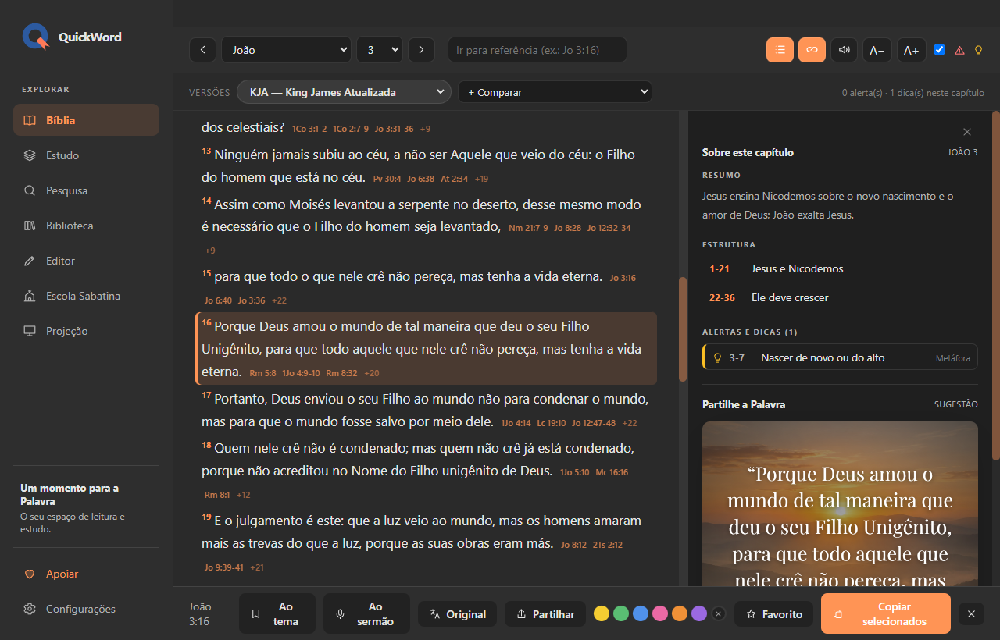
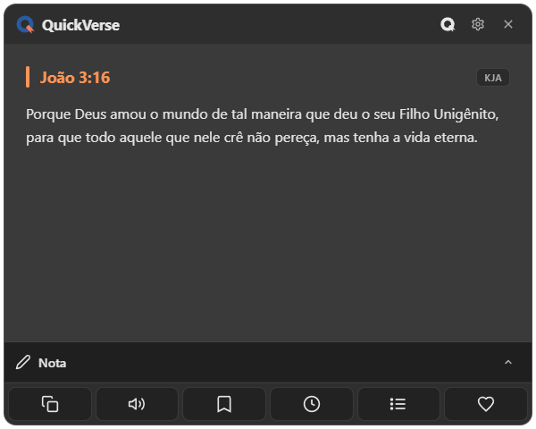
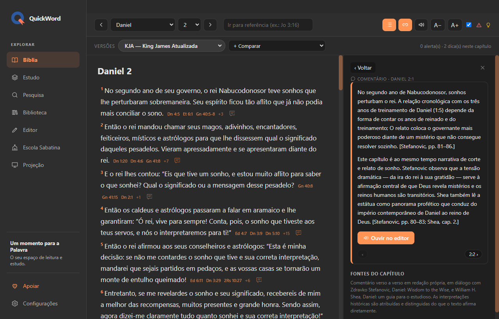
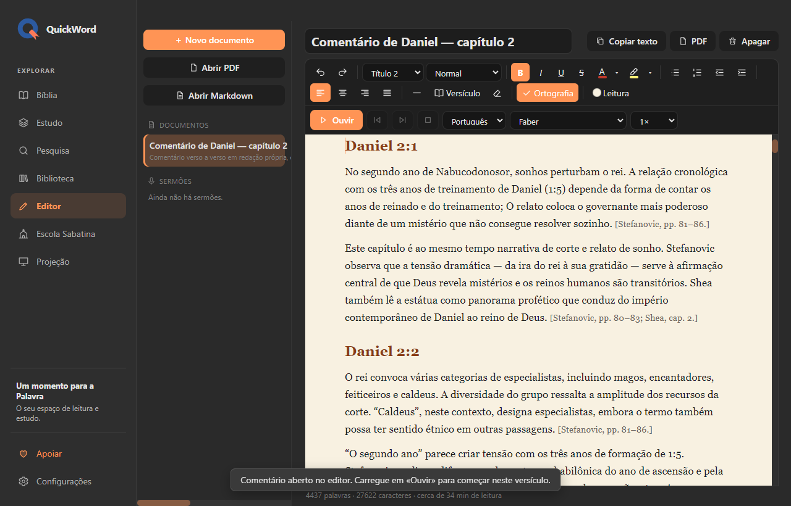
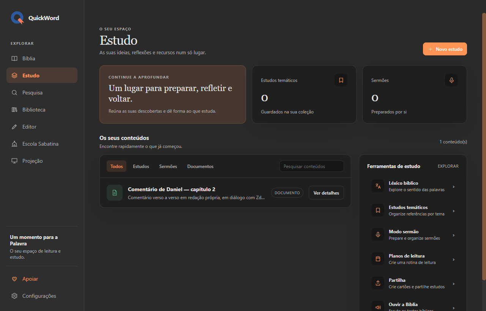
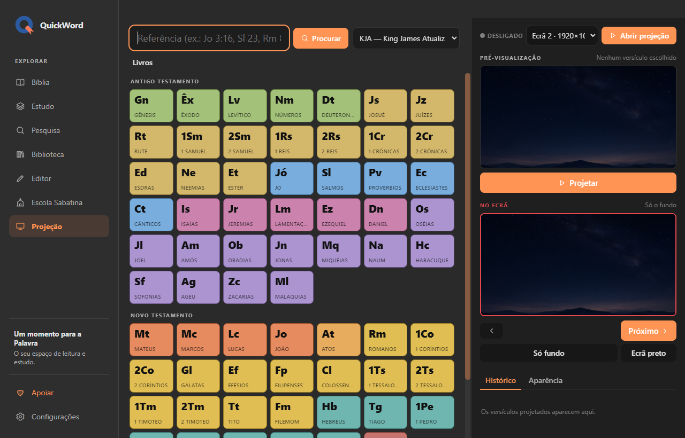

# QuickVerse e QuickWord

Estudo bíblico rápido no computador. São dois programas num só instalador:

- **QuickVerse** — uma janela pequena que mostra na hora o versículo que acabou de copiar.
- **QuickWord** — a Bíblia completa para ler, comparar, pesquisar, estudar, escrever e projetar.

Funciona sem internet, em português, inglês e espanhol.

**[⬇ Descarregar a versão mais recente](https://github.com/arqomes/quickverse/releases/latest)**

*English summary at the [end of this page](#english).*

---

## Instalar

1. Abra a página de [lançamentos](https://github.com/arqomes/quickverse/releases/latest) e descarregue `QuickVerse-Setup-<versão>.exe`.
2. Execute o ficheiro e siga o assistente. O Windows pode mostrar um aviso por o instalador não ter assinatura digital; escolha **Mais informações → Executar assim mesmo**.
3. Ficam dois atalhos: **QuickVerse** e **QuickWord**.

Requisitos: Windows 10 ou 11 (64 bits) e cerca de 1 GB de espaço em disco.

### Atualizações

A partir da versão 1.1.0 não é preciso desinstalar nada. O programa verifica sozinho se há novidades (ao abrir e de 6 em 6 horas):

- **Comentários novos** são descarregados e aparecem logo, sem reiniciar.
- **Versão nova do programa**: aparece um aviso; escolha **Descarregar** e depois **Reiniciar e instalar**.

As suas notas, destaques, documentos e sermões são mantidos. Para verificar à mão: **Configurações → Atualizações → Verificar agora**, ou clique com o botão direito no ícone junto ao relógio.

---

## QuickVerse — o versículo na hora

1. Em qualquer programa (navegador, Word, PDF), selecione e copie uma referência, por exemplo `João 3:16`, `Sl 23` ou `Rm 8:28-30`.
2. Carregue em **Ctrl + Alt + A**.
3. O texto aparece numa janela pequena, por cima das outras.

Na barra de baixo pode copiar o texto, ouvi-lo, marcá-lo como favorito, ver o histórico, escolher livro e capítulo à mão e escrever uma nota. O botão do topo abre a mesma passagem no QuickWord.

O QuickVerse fica no ícone junto ao relógio e arranca com o Windows (pode desligar isso nas Configurações).

---

## QuickWord — ler e estudar

### Bíblia

- **Ir a uma passagem:** escolha livro e capítulo, ou escreva a referência (`Jo 3:16`).
- **Comparar versões:** em **+ Comparar**, junte outras traduções lado a lado.
- **Referências cruzadas:** aparecem no fim de cada versículo; clique para ver o texto.
- **Comentário, dicas e alertas:** os ícones no fim do versículo abrem o comentário verso a verso (disponível para Daniel e Apocalipse), dicas de leitura e alertas sobre passagens difíceis.
- **Línguas originais:** selecione um versículo e escolha **Original** para ver o hebraico ou o grego, palavra a palavra, com léxico.
- **Destaques e favoritos:** selecione um versículo e escolha uma cor; dê um nome a cada cor nas Configurações.
- **Partilhar:** crie um cartão de imagem com o versículo.

Traduções incluídas: King James Atualizada, Bíblia Livre, Nova Bíblia Viva, Almeida 1911 e Bíblia Livre Para Todos (NT) em português; King James Version, World English Bible e Berean Standard Bible em inglês; Reina-Valera 1909 e Versión Biblia Libre em espanhol.

### Ouvir

O programa lê em voz alta, sem internet:

- um capítulo da Bíblia (botão de som na barra do leitor);
- um comentário: no painel do comentário, **Ouvir no editor** abre o capítulo no Editor com o cursor no versículo; depois carregue em **Ouvir**;
- qualquer texto seu no Editor, incluindo ficheiros **PDF** e **Markdown** que abrir.

Pode escolher a voz e a velocidade.

### Estudo

- **Estudos temáticos:** junte versículos por tema.
- **Modo sermão:** prepare e organize sermões.
- **Planos de leitura:** crie uma rotina e marque o que já leu.
- **Léxico bíblico:** procure palavras hebraicas e gregas.
- **Editor:** escreva documentos com formatação, insira versículos e exporte para PDF.

### Pesquisa e Biblioteca

Procure palavras ou expressões em toda a Bíblia, só num testamento ou num livro. A Biblioteca reúne os seus favoritos, destaques, notas e histórico.

### Escola Sabatina

Leia a lição da semana dentro do programa. Depois de aberta uma vez, fica guardada para estudar sem internet.

### Projeção

Para a igreja: escolha o segundo ecrã (projetor ou televisão), procure a passagem e clique em **Projetar**. Há pré-visualização, histórico do que já foi projetado, fundo e tipo de letra à escolha, e botões para mostrar só o fundo ou ecrã preto.

---

## Perguntas frequentes

**Preciso de internet?** Não, para ler, pesquisar, estudar e ouvir. A internet só é usada para as atualizações, a lição da Escola Sabatina e a voz de alta definição (opcional).

**Onde ficam os meus dados?** No seu computador, na pasta de dados do programa. Nada é enviado para fora.

**Como mudo o idioma ou o tema?** Em **Configurações**: tema claro, escuro ou suave, cor de destaque, tipo e tamanho de letra, e idioma (português, inglês ou espanhol).

**Encontrei um erro ou tenho uma sugestão.** Abra um pedido em [Issues](https://github.com/arqomes/quickverse/issues).

---

## Créditos

Textos hebraico e grego e léxicos: STEPBible.org, Tyndale House (CC BY 4.0). Referências cruzadas: OpenBible.info (CC BY). Vozes: Piper e Kokoro. Tipos de letra dos cartões: Google Fonts (SIL Open Font License).

Desenvolvido por Danilson Gomes.

---

## English

**QuickVerse** shows a Bible verse instantly: copy a reference anywhere (for example `John 3:16`), press **Ctrl + Alt + A**, and the text appears in a small window.

**QuickWord** is a full Bible study app: parallel translations, cross references, verse-by-verse commentary, Hebrew and Greek with lexicon, search, highlights, reading plans, a document and sermon editor, offline read-aloud, and projection for church services.

It works offline, with the interface in Portuguese, English and Spanish. Since version 1.1.0 the app updates itself and keeps your notes and documents.

**[Download the latest version](https://github.com/arqomes/quickverse/releases/latest)** (Windows 10/11, 64-bit).
